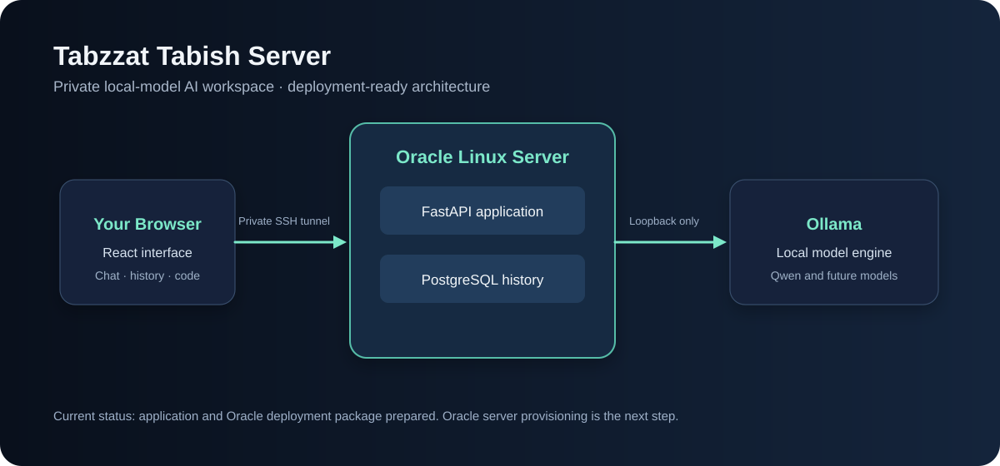

# Tabzzat Tabish Server

> A private, self-hosted AI workspace powered by local Ollama models — designed by Tabish Syed.

Tabzzat Tabish Server is a full-stack personal AI server project. It provides a custom browser chat interface, a FastAPI gateway, durable conversation history, local model management through Ollama, and a prepared deployment path for an Oracle Cloud Ubuntu server.

The goal is to run the model and retain the data under the server owner's control, without relying on third-party AI inference APIs.



## Why this project exists

Most AI chat products place model execution, conversation history, and personal work in someone else's cloud. This project explores a smaller, personal alternative: a server selected and administered by its owner, with local model inference, a custom interface, and deliberate safety boundaries for future tools.

The initial development target was an 8 GB MacBook. That machine can develop the interface and run small models, but it is not the intended production host. The project therefore includes an Oracle Cloud deployment package so Ollama can run on a separate Linux machine instead of using the MacBook's memory during normal use.

## What is implemented

| Area | Included |
| --- | --- |
| Local inference | Ollama adapter with streamed chat responses and selectable installed models |
| Chat experience | Custom React + TypeScript interface with model selection, stop generation, history sidebar, and message streaming |
| Durable history | SQLAlchemy models for conversations and messages; SQLite for local development and PostgreSQL support for deployment |
| Context control | Server-owned history, bounded prompt construction, conservative context estimate, and a visible truncation notice |
| Reliability | Partial-response checkpoints, interrupted/error states, model validation, per-conversation generation lock, and actionable Ollama errors |
| Coding help | Rendered headings, lists, quotes, inline code, fenced code blocks, and copy-to-clipboard buttons |
| Local-only design | Ollama stays behind the FastAPI service; no OpenAI, Claude, Gemini, or other inference API is used |
| Deployment prep | Oracle Ubuntu bootstrap script, Docker images, PostgreSQL service, Caddy web service, and private SSH-tunnel access |

## Architecture

```text
Browser
  │
  ├── React + TypeScript interface
  │
  └── FastAPI server
        ├── Ollama inference backend
        ├── Conversation + message persistence
        └── PostgreSQL in deployment / SQLite during local development
```

For the prepared Oracle setup, the browser connects through an SSH tunnel. The server runs the web service, FastAPI, PostgreSQL, and Ollama. The model workload does not run on the MacBook.

## Quick start: local development

Prerequisites: Ollama, Python 3.11+, and Node.js 20+.

```bash
ollama pull qwen2.5-coder:3b
```

Start the backend:

```bash
cd backend
python3 -m venv .venv
source .venv/bin/activate
pip install -r requirements.txt
uvicorn app.main:app --reload --port 8000
```

Start the frontend in a second terminal:

```bash
cd frontend
npm install
npm run dev
```

Open the address printed by Vite, normally `http://127.0.0.1:5173`.

## Deploy to Oracle Cloud

The deployment files live in [infrastructure/oracle](infrastructure/oracle/README.md).

They prepare:

1. An Ubuntu server with Docker and Ollama.
2. PostgreSQL for production conversation storage.
3. A Caddy web service that proxies API calls to FastAPI.
4. Loopback-only web access on the server, opened privately from a Mac through SSH.

Oracle account creation and VM provisioning are not complete at the time of publication. The server package is prepared for an Always Free Ampere A1 Ubuntu VM, subject to capacity and account eligibility.

## Project journey

This repository documents the work completed by Tabish Syed:

- Defined a personal AI-cloud architecture with React, FastAPI, Ollama, PostgreSQL, agent orchestration, isolated notebooks, and dedicated Linux hardware.
- Built the first working custom chat milestone instead of using an off-the-shelf UI.
- Connected the interface to locally installed Qwen models through a private FastAPI gateway.
- Added saved chats, streaming, cancellation, durable message state, and context budgeting.
- Designed a pluggable `InferenceBackend` contract so Ollama can later be replaced by another local engine, such as MLX, without rewriting the interface.
- Prepared a private Oracle Cloud deployment path so the model can move off the MacBook.
- Chose SSH-tunnel access as the initial remote-access approach so the service is private by default.

See [the full project notes](docs/PROJECT_STORY.md) and [the roadmap](docs/ROADMAP.md).

## Current limits

This is a single-owner, local-first project. Authentication, file indexing, isolated notebook execution, agent tools, backups, monitoring, and a live Oracle server are planned but not yet implemented. A local model can also be wrong; future versions should be evaluated on real user tasks before expanding its permissions.

## Technology

- Frontend: React, TypeScript, Vite
- Backend: FastAPI, Python
- Inference: Ollama
- Storage: SQLite locally, PostgreSQL for deployment
- Packaging: Docker Compose and Caddy
- Private access: SSH tunnel

## Repository layout

```text
backend/                  FastAPI API, data models, and inference adapters
frontend/                 React chat interface
infrastructure/oracle/    Oracle Ubuntu deployment package
docs/                     Architecture, roadmap, and project notes
```

## License

MIT © 2026 Tabish Syed
